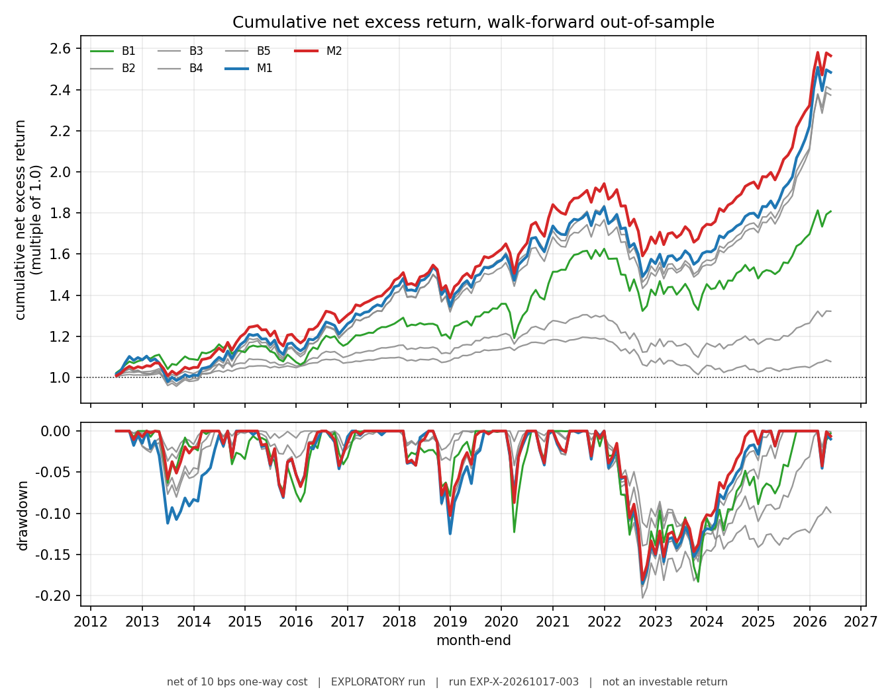
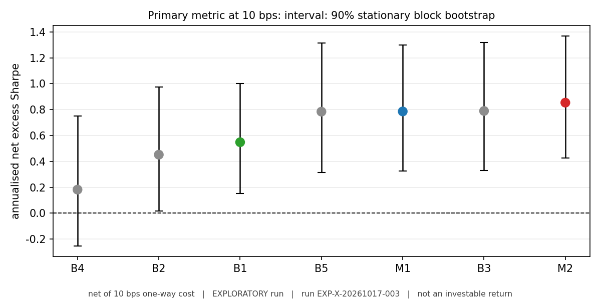

# robustfolio

**A pre-registered evaluation benchmark for portfolio construction — with a published power audit and a pre-specified external out-of-sample replication.**

**Thesis.** In portfolio research, the binding constraint is usually the **evaluation**, not the method. The comparator, the test's power, and the sample decide the verdict more than the strategy does.

**Three contributions.**

1. A **single-factor registered comparison**: seven constructions on 18 US ETFs over 168 months, where each treatment differs from the baseline in exactly one component.
2. A **power audit of the registered gate**: it required an observed gap of 0.478 to certify a 0.20 bar, and had about 24% power at 0.20.
3. A **pre-specified external replication** on 18 country ETFs: the best baseline changed from sample MVO to equal weight, and the treatment edge did not replicate.

**Evidence level.** The first sample is exploratory and non-confirmatory: the registered test was executed without the blindness its registration required (finding **F26**), so the hypotheses are *untested, not falsified*. The country sample is a pre-specified external replication; the repository does not independently establish that its protocol was frozen before execution, so it is **not labeled confirmatory**. Empirical quantitative-finance research with a data-science evaluation stack; not a trading system, not a claim of alpha, not a machine-learning project.

**Read:** [research brief](essays/robustfolio-research-brief.pdf) · [working paper](essays/robustfolio-working-paper.pdf) · [evaluation checklist](docs/evaluation-checklist.md) · [positioning](docs/positioning.md) · [protocol](docs/evaluation_protocol.md) · [reproduce](#reproduce-it)

[](docs/evaluation_protocol.md)
[](docs/model_and_method_spec.md)
[](https://github.com/kira-ml/robustfolio/actions/workflows/ci.yml)
[](https://github.com/kira-ml/robustfolio/releases/latest)
[](LICENSE)

---

## Result

> **Exploratory, non-confirmatory** (DEC-20261015-012). These numbers may not be cited for or against any hypothesis. The registered confirmatory test (`EXP-H2-20261017-001`) is **executed (non-confirmatory)**: its answer was observed before it ran, because validating the report generator required executing the frozen configuration (finding **F26**, DEC-20261017-034). No confirmatory test therefore exists, and the hypotheses are **untested, not falsified**. See [Limitations](#limitations) and findings F24–F26, F31.

**Neither robust method was successful under the frozen decision rule.** Over 168 out-of-sample months on a point-in-time universe of 18 US ETFs, the best baseline was `B3` — plain sample-covariance, sample-mean MVO, the method the project set out to critique.

| Method | Net Sharpe @ 10 bps | 90% bootstrap CI | Gross (diagnostic only) |
|---|---|---|---|
| `B1` equal weight (1/N) | 0.5482 | [0.153, 1.002] | 0.5527 |
| `B2` risk parity (ERC) | 0.4519 | [0.017, 0.974] | 0.4592 |
| **`B3` sample MVO — best baseline** | **0.7896** | [0.331, 1.318] | 0.8151 |
| `B4` minimum variance | 0.1820 | [-0.253, 0.751] | 0.1953 |
| `B5` turnover-penalised MVO | 0.7843 | [0.316, 1.316] | 0.7926 |
| `M1` shrinkage-covariance MVO | 0.7860 | [0.327, 1.298] | 0.8077 |
| `M2` Bayesian (Black–Litterman) MVO | **0.8538** | [0.426, 1.369] | 0.8791 |

Net Sharpe is the **only** metric allowed to decide whether a method beats a baseline (protocol §2). `M2`'s advantage over `B3` is **+0.064** against a materiality bar of **0.20** (§6.2), and its probabilistic Sharpe ratio against `B3` is **0.587** against a bar of **0.95** (§6.1). Both candidates therefore return **FAILURE** under §6.4 — `M1` at −0.004 and `M2` at +0.064.

> **Correction 2026-11-04 (exploratory).** The §6.1 PSR gate is a **level** test and requires an observed gap of about **0.48**; its 80%-power MDE is about **0.72**. The design's 0.13–0.20 power claim applies to the **paired** test, which the gate does not use. On the paired stationary bootstrap, `M2` is **+0.064 [−0.011, +0.147]**, `P(Δ>0) = 0.917`, and the 90% upper bound rules out a 0.20 advantage at the 5% level; `M1` is −0.004 [−0.096, +0.080]. The frozen verdict is unchanged. Full note: [`notes/paired_inference_2026-11-04.md`](notes/paired_inference_2026-11-04.md). Reproduce with `python scripts/paired_inference.py --run results/<run>`.

The part worth reading closely: both candidates *pass* the deflated Sharpe p-value (0.0032 and 0.0017), because the DSR is measured against a **zero** benchmark. They fail the PSR, because that is measured against the **best baseline**. §6.1 requires both, and the first run is a live demonstration of why.

**The null is informative, but not in the way the first write-up said.** The paired comparison is powered to separate roughly 0.13–0.20 (ρ = 0.9845 and 0.9856), and on that test `M2` is +0.064 [−0.011, +0.147]: plausibly a little better, but not by enough to matter, and the 90% upper bound rules out a 0.20 advantage. The registered *level* PSR gate is a different test; it needs about 0.48 observed and has an 80%-power MDE of about 0.72, so it could not have detected a 0.20 effect most of the time. The effect is small; the original “not underpowered” sentence was true of the paired test and false of the gate.

The deliverable is the **apparatus**, not the number: a leakage-tested walk-forward engine, a numerical certificate, a pre-registered decision rule, and a report that prints the comparison it failed on.



*Run `EXP-X-20261017-003`, net of 10 bps one-way cost, exploratory. Cumulative net **excess** return is the path of the primary metric's input, not an investable return. It is shown because a null is easier to trust when the sample is visible: all seven are the same strategy family on the same 18 instruments, and the four front-runners — `B3`, `B5`, `M1`, `M2` — are visually bundled while spanning 0.784 to 0.854 on the metric, a 0.07 spread their intervals cannot separate. Regenerate with `python scripts/make_figures.py --run results/EXP-X-20261017-003`.*



These are static renders from the run; see [`docs/figures/README.md`](docs/figures/README.md)
for why they are not regenerated in CI.

*The same run's primary metric. `M2` leads the best baseline by +0.064 against a 0.20 bar, and every interval overlaps `B3`'s. The DSR p-values (0.0032, 0.0017) are measured against zero; the PSR (0.495, 0.587) against `B3` — §6.1 requires both.*

---

## New sample — country ETFs, 2005–2026

A second, **pre-specified** sample tests the reading on a different cross-section and period:
18 current-listed iShares MSCI country ETFs, 2005-07 to 2026-06, 252 months in 21 folds,
same seven methods, same 0.20 bar, and the corrected paired significance gate. The protocol is
dated 2026-11-05, but its final content was written after the results; the repository does not
independently establish that it was frozen before execution. The result is reported regardless
of direction and is **not labeled confirmatory**.

| Method | Net excess Sharpe |
|---|---:|
| **B1 equal weight** | **0.3527** |
| B2 risk parity | 0.3423 |
| M2 Black–Litterman | 0.3193 |
| B5 turnover-penalised | 0.2919 |
| B3 sample MVO | 0.2797 |
| B4 minimum variance | 0.2715 |
| M1 shrinkage | 0.2710 |

The best baseline is **B1 (1/N)**, not B3. `M2` is below it by 0.033 [90% range −0.125, +0.075];
`M1` is below it by 0.082 [−0.175, +0.029]. Both upper bounds are below 0.20, both won 0 of 5
cost levels, both traded about 3× the baseline's turnover, and both fail. The treatment
advantage did not replicate; the benchmark lesson did: the comparator is a property of the
sample.

**Claim status.** The country results were written at 19:51:35 on 2026-11-05; the protocol file was last written at 20:08:45, and both were committed together at 20:09:27. The repository therefore cannot establish that the protocol was frozen before execution. See [`notes/audit_2026-11-08.md`](notes/audit_2026-11-08.md).

Full note: [`notes/country_sample_result_2026-11-05.md`](notes/country_sample_result_2026-11-05.md).
Protocol record: [`notes/confirmatory_country_etfs_2026-11-05.md`](notes/confirmatory_country_etfs_2026-11-05.md).
Published tables: [`docs/published-run/country-sample/`](docs/published-run/country-sample/).

## Reproduce it

```bash
git clone https://github.com/kira-ml/robustfolio.git && cd robustfolio
python -m pip install -e ".[dev,paper]"
```

**What runs without the data.** These need no snapshot and no network:

```bash
python scripts/certify_engine.py    # 7 methods x 168 rebalances, KKT certificate
python scripts/demo_the_check.py    # watch the check reject a tampered verdict
python scripts/run_synthetic_demo.py --out results/synthetic-demo
                                     # full pipeline on a deterministic synthetic panel
python -m pytest -q                 # the full suite

# The public one-sheet, redrawn from the published tables.
python scripts/make_onepager.py --out essays/one-pager

# The two shapes a post needs: a 4:5 feed card and a 2:1 link card, same tables.
python scripts/make_cards.py --out essays/one-pager

# The working paper and the eight-slide carousel, from the same tables.
# Needs the optional extra: pip install -e ".[paper]"
python scripts/build_paper.py
```

`run_synthetic_demo.py` is an **end-to-end demonstration, not a reproduction**: it builds a deterministic five-asset panel with a split and dividends, runs all seven methods through the real harness and report builder, and writes a run directory. It is what a fresh clone can exercise without the restricted data.

**Exact reproduction is not offered.** The tables were computed from a frozen snapshot of Yahoo Finance prices and FRED `DGS1MO`. The upstream terms do not permit redistribution: Yahoo restricts automated collection and grants no redistribution right, and FRED prohibits archiving FRED content or providing it to third parties. The snapshot archives and checksums were **removed** from the `v1.0.0` and `v1.1` releases on 2026-11-06. [`docs/data_licenses.md`](docs/data_licenses.md) records each file, its terms, and the decision; [`docs/open_source_and_license_policy.md`](docs/open_source_and_license_policy.md) v1.2 is the policy.

The input's identity is retained so a reader can tell which snapshot produced the numbers:

```text
snapshot id   yahoo-usetf-2007-01-01_2026-09-30-2026-10-17-2ad06139
bundle hash   2ad0613913df9065b62ba2291abc391402c1eb13d36937ba8c2bbc09d637d707
archive sha   7a3fc20991b664099ada44a308dfde57d8080994ff498e2f5a0dd98f2ecab77d
              (the withdrawn distribution; this is not a download)
```

`scripts/verify_release.py` still compares a fresh run against the committed tables, but it needs a snapshot archive as input. Because the archives are not distributed, a third party cannot run that check end to end from this repository alone. That is a real degradation, and it is stated as one: the data terms take precedence over exact reproduction.

A reader who independently has licensed access to the same data can use `scripts/build_snapshot.py` and `scripts/pack_snapshot.py`; the snapshot format is documented below. A rebuilt snapshot gets a different id and slightly different numbers, because Yahoo revises history. **Rebuilding is not reproduction.**

**The check turned on itself.** `demo_the_check.py` tampers with in-memory copies of the published tables and prints what the comparison does with each: a measurement moved by `0.01` is **refused** and the column named; a verdict flipped `FAILURE → SUCCESS`, with every statistic untouched, is **refused** (`VERDICT differs`) — that is DEC-20261018-041 executed rather than asserted; and a `1e-12` difference, the scale a different machine produces, is **absorbed**, because a check that fails on platform noise is useless. No real run has ever disagreed with the published verdict, so this demo is the only evidence that the refusal works at all. It exits non-zero if any of the three stops behaving that way, so it is also a test. It writes nothing.

`run_experiment.py` writes `manifest.json` (snapshot id, git commit, protocol and spec versions, seed, environment), `outcomes.csv`, `decisions.csv`, `calibration.csv`, `design.csv`, `folds_<M>.csv`, `net_excess_returns.csv`, and `report.md`.

**The reference tables are in the repository.** `docs/published-run/` holds the run's `outcomes.csv` (4.8 KB) and its `decisions.csv` (1.1 KB) — the metric table these numbers come from, and the verdict table that records what the frozen §6.1–§6.4 rules concluded from it — committed so that the verifier can be a *comparison* rather than a one-off. Without them a verifier can only ever say "my run finished", which is a different and much weaker statement. CI runs the hermetic suite, the one-pager, and the paper; it cannot run the archive comparison because no archive is published — see [`docs/published-run/README.md`](docs/published-run/README.md).

**The claim is split — decisions exact, measurements bounded — and it took two failures to get there.** The first comparison run failed by `4.2e-17` on exactly one of the eighteen columns: `autocorr1` reached a BLAS kernel that OpenBLAS selects from the CPU's features at run time, so the same archive and the same code agreed bit-for-bit on one machine and not on another. That metric now uses a correctly-rounded summation (`math.fsum` plus the primitives IEEE-754 requires to be correctly rounded), which is bit-identical anywhere and slightly *more* accurate — finding **F33**, DEC-20261018-037.

The next run failed harder: thirteen columns, worst `4.698e-12`. That one is not fixable the same way, and the honest reading is the interesting one — **a quadratic program is solved only to its solver's tolerance**, so the optimal portfolio is defined to about `1e-14` and the published digits are a property of *(snapshot, code, machine)* rather than of the snapshot alone. Finding **F34**, DEC-20261018-038. So the verifier splits its claim instead of widening it: every **decision-bearing** quantity (method set, rebalance and fold counts, headline cost level, the ranking by net Sharpe, which baseline the rules select, and — from `decisions.csv` — each of the eight gates, the three summary flags and the `verdict` itself) is compared **exactly** and fails on *any* difference, while the continuous quantities in both tables are compared against a documented `1e-9` — 200× the worst cross-platform difference measured, and five orders of magnitude below the four decimals any of these numbers is quoted at. The observed worst difference is printed on every run either way. A verifier that tolerates a reordering is not a verifier.

**Third-party data is not MIT-licensed and is not redistributed.** The prices and corporate actions are Yahoo Finance data, subject to Yahoo's terms; the risk-free series comes from FRED, whose terms restrict archiving and third-party provision. The repository's MIT licence covers the code and this project's own artefacts, not that data. A locally packed archive carries a `NOTICE.txt` saying this, but the notice is a provenance statement, not a redistribution licence. Full record: [`docs/data_licenses.md`](docs/data_licenses.md).

---

## Using the harness on your own data

The seam is the **snapshot directory**. A snapshot is five files, and the data layer verifies every hash in `manifest.json` before it will read anything, so nothing downstream can be silently fed a different panel:

| File | Contents |
|---|---|
| `prices_raw.parquet` | `DatetimeIndex` × `MultiIndex` columns `(field, ticker)`, fields `close`/`open`/`high`/`low`/`volume`; **unadjusted** prices |
| `actions.parquet` | `ticker`, `ex_date`, `kind`, `value` — splits and dividends, applied at their ex-date |
| `rf_dgs1mo.parquet` | `date`, `dgs1mo` — the risk-free series, aligned prior-month and annualised geometrically |
| `universe_pit.csv` | `ticker`, `first_eligible`, `last_eligible`, `source_note` — **what makes eligibility point-in-time**; a ticker outside its window is absent, not forward-filled |
| `manifest.json` | per-file SHA-256, content hash, snapshot id, retrieval date, source |

Everything else is generic: `backtest.run_method(snapshot, method_id)` runs one method through the walk-forward loop and returns its per-rebalance record, and `report.build_report(...)` turns a set of those into the table above. `scripts/build_snapshot.py` is the only file that knows how to *produce* a snapshot, and it is the only file you need to change to point the benchmark at a different price panel.

A **packaged archive** is those five files plus a generated `NOTICE.txt` recording where the data came from, that MIT does not cover it, and that it is not for redistribution. The archive is a local artefact; it is not published. A snapshot you build yourself does not need one — the notice is about *redistributing* the data, not about reading it.

---

## What is built

| Component | State |
|---|---|
| Evaluation protocol | **Frozen** v2.4 — metrics, thresholds, hypotheses, registry rules, firewalls |
| Method spec | **Frozen** v1.1 — estimators, optimizer, harness, metric definitions |
| Universe | 18 US ETF candidates, point-in-time eligibility (17–18 eligible at each rebalance), anchored 2012-06 |
| Methods | 5 baselines (`B1`–`B5`) + 2 robust treatments (`M1`, `M2`), differing in exactly one component from `B3` |
| Walk-forward harness | 60-month rolling estimation, 12-month non-overlapping test blocks, monthly rebalance, 168 OOS months / 14 folds |
| Optimizer | CVXPY + CLARABEL, **no fallback path**, every rebalance certified by a primal KKT residual against a frozen tolerance |
| Engine certificate | 7 methods × 168 rebalances = **1,176 solves, zero rejections**; worst KKT residual `1.49e-11` vs `1e-7` acceptance |
| Leakage suite | protocol §5.4.8 — 14 pass, 1 recorded skip (the survivorship test is vacuous in-sample; see below) |
| Tests | 297 passed, 1 skipped - including the country-claim correction test, the synthetic end-to-end demo, the verifier's mutation suite (every exact field, method order, ranking, baseline, notice, gate, flag, and verdict), the leakage suite, release-packaging integrity (the notice included), snapshot-name integrity, metric determinism, the verifier's own exact/bounded split for both published tables, the paired-inference and cap-sweep calculations, the generated one-pager and its two social cards (their numbers, their required disclosure, their margins, that the page still fits on one page, and that a card changed in memory changes on the image), the eight-slide carousel (slide count, rendered numbers, no typed measurement), the working paper (every table value present in the rendered PDF, no measurement typed into its source, the prohibited claims absent), the research brief, repository consistency (package/citation versions and unique CSV headers), and the documentation index |
| Packaging chain | Frozen snapshot packs to a deterministic 1.67 MB archive with an external SHA-256 and a `NOTICE.txt` recording the data's provenance and that it is not for redistribution. The archive is local-only; it is not published. `verify_release.py` re-runs the harness from an archive and compares the result to the published tables — every decision exactly, including the verdict, and the measurements within the documented bound |
| Continuous integration | Hermetic suite green on a fresh clone by design: no snapshot, no network, no archive fetch. CI also rebuilds the one-pager and the paper from the committed tables. The end-to-end archive comparison is not run in CI because no archive is published; it remains available locally to anyone who has one |

---

## Limitations

These are the honest ones, not a disclaimer. The full list is in the report and in [`docs/decision_log.md`](docs/decision_log.md).

- **The headline run is exploratory, and the confirmatory slot is now empty.** Validating the report generator required executing the frozen configuration first, so the registered confirmatory test's answer was observed before the test ran. It has been re-designated **executed (non-confirmatory)** rather than repaired, because blindness cannot be restored once lost (finding **F26**, DEC-20261017-034). The consequence is worth stating plainly: **no confirmatory test now exists**, so no hypothesis is confirmed *or* falsified here — the frozen decision rule returns failure for both candidate methods either way, but it was never applied blind, and this README will not call it a test. What a valid one would require: a **new sample** (a different asset class, or a period that does not yet exist), registered before the data does.
- **The country sample is an external replication, not a confirmatory test.** Its protocol is dated 2026-11-05, but the file was last written after the results, and the protocol and results were committed together. The repository cannot establish that the freeze preceded execution, so the sample is not labeled confirmatory; see [`notes/audit_2026-11-08.md`](notes/audit_2026-11-08.md).
- **"Point-in-time" here means point-in-time *eligibility*, not point-in-time *data*.** The universe is correctly reconstructed from date-stamped eligibility windows, so no instrument appears before it existed. But the prices are what a 2026 source holds for 2012 today, and price history is revised. A perfect reconstruction of Yahoo's current history is still not the history a trader saw.
- **168 out-of-sample months and 18 ETF candidates** (17–18 eligible at any rebalance). On the **paired** test this sample can separate roughly a 0.13–0.20 net Sharpe difference between these highly correlated strategies, and not much less. The registered **level** PSR gate is much less powerful (80%-power MDE ≈ 0.72); see the correction above and [`notes/paired_inference_2026-11-04.md`](notes/paired_inference_2026-11-04.md).
- **The cost model is a flat 10 bps with no market impact, capacity, taxes, or regime dependence.** Costs cannot reach the optimizer: each rebalance is solved once and every cost level is derived from that single turnover series, so a cost level cannot influence the weights it prices.
- **Survivorship is argued by construction, not measured.** The survivorship test (§5.4.8 test 2) is vacuous in-sample: no confirmed candidate delisted between 2012-06 and 2026-05 (§5.4.5).
- **Data provenance is Yahoo Finance and FRED**, frozen into an immutable local snapshot with a quality report. It is not an institutional point-in-time vendor feed. The third-party data is not MIT-licensed and is not redistributed; see [`docs/data_licenses.md`](docs/data_licenses.md) and [`docs/open_source_and_license_policy.md`](docs/open_source_and_license_policy.md).
- **Two specification readings are disclosed, not silent.** §7.8 leaves the object of its prediction interval undefined, so only the *return* half is reported (coverage 81.5–87.0%); the volatility half is deliberately **not** implemented. §6.3's "advantage" is not pinned to a metric, so fold wins use net Sharpe and the concentration clause uses per-fold mean return — **and that reading decides the verdict here** (findings F24, F25).
- **Not investment advice, and not a claim of tradable alpha.** Nothing here is a live trading system, and no absolute return claim is made (protocol §14.2).
- **The verification path had four bugs, and all four produced plausible numbers.** The first snapshot verifier rejected *every* valid snapshot, because `manifest.json`'s hash map lists five files while the content hash is derived from four (finding **F27**). The first comparison of the archived snapshot against the published table reported an `8.3e-17` mismatch on `B4`, because `pandas.read_csv` is lossy by one ULP at its default settings — only `float_precision="round_trip"` is exact (finding **F28**). Then the comparison falsified **this repository's own claim**, twice, within two commits: first one metric that reached a BLAS kernel chosen from the CPU's features at run time (finding **F33**), then thirteen metrics on a second machine, because a solver's output is only defined to the solver's tolerance (finding **F34**). Neither was a defect in the data. Both were claims broader than the mechanism underneath them, which is the failure this project exists to look for. The limit that remains is stated above and in [`docs/published-run/README.md`](docs/published-run/README.md): **when a snapshot archive is supplied, decisions reproduce exactly, measurements to a documented bound, and the number this machine actually achieved is printed on every run.**

---

## Related project

[`epistemic-dro`](https://github.com/kira-ml/epistemic-dro) asks a different question under the same evaluation discipline: whether ML epistemic uncertainty improves a DRO mean-CVaR portfolio. It reports H1/H3 failures, an H2 non-inferiority pass, and a documented stop before the untouched 2025-2026 holdout. The repositories share evaluation language and standards, not code or data.

The synthesis is [`Two nulls, one evaluation problem`](essays/two-nulls-one-evaluation-problem.md): what the two results teach about comparator choice, power, gate error rates, and holdout discipline.

---

## Documentation

The contracts live in [`docs/`](docs/) and are the authority: **if this README and the docs disagree, the docs win.**

- [`docs/evaluation_protocol.md`](docs/evaluation_protocol.md) — frozen metrics, thresholds, hypotheses, registry and firewalls
- [`docs/model_and_method_spec.md`](docs/model_and_method_spec.md) — frozen method, estimator, optimizer and metric definitions
- [`docs/problem_framing.md`](docs/problem_framing.md) · [`docs/scope_and_non_goals.md`](docs/scope_and_non_goals.md)
- [`docs/risk_register_and_premortem.md`](docs/risk_register_and_premortem.md) — how this project fails
- [`docs/decision_log.md`](docs/decision_log.md) — every governance decision, the experiment registry, and findings F1–F34
- [`docs/data_licenses.md`](docs/data_licenses.md) — per-file source, governing terms, redistribution status, and the 2026-11-06 removal record
- [`docs/results_reporting_and_claims_policy.md`](docs/results_reporting_and_claims_policy.md) — what may be claimed from a result, and the reporting template that binds future experiments (v1.0, frozen)
- [`essays/`](essays/) — the written account: what the four defences caught, the one that failed, and two audience-specific cuts (§14.2 governs them, and every number in them is checkable against this repository)
- [`essays/one-pager.pdf`](essays/one-pager.pdf) - the one-sheet version, **generated** from the published tables by `scripts/make_onepager.py` so that no number on it was typed by hand; [`tests/test_onepager.py`](tests/test_onepager.py) checks it against `docs/published-run/` and fails if it stops fitting on one page. The same tables draw `essays/one-pager-social.png` (4:5, 1200x1500) and `essays/one-pager-card.png` (2:1, 1280x640) through `scripts/make_cards.py`, because a feed and a link preview cannot both be served by an A4 sheet
- [`essays/robustfolio-carousel.pdf`](essays/robustfolio-carousel.pdf) - the **eight-slide LinkedIn carousel** for the 2026-11-04 correction and the 2026-11-05 country-ETF replication, drawn in Typst from `paper/generated/paired.typ` and `paper/generated/country.typ` by `scripts/build_paper.py`; [`essays/robustfolio-carousel-cover.png`](essays/robustfolio-carousel-cover.png) is its 4:5 cover. It opens on the test's blind spot, then sets out the problem, the benchmark, the result, the flaw, the correction and the new sample. [`tests/test_carousel.py`](tests/test_carousel.py) fails if the slide count changes, if a headline number is missing from the rendered PDF, or if a measurement is typed into the Typst source
- [`notes/paired_inference_2026-11-04.md`](notes/paired_inference_2026-11-04.md) - the exploratory note behind the carousel: the registered PSR gate required about 0.48 observed and had an 80%-power MDE of about 0.72, while the paired test gives `M2` +0.064 [−0.011, +0.147]. It does not change the frozen verdict
- [`notes/cap_sweep_shrinkage_2026-11-04.md`](notes/cap_sweep_shrinkage_2026-11-04.md) - the mechanism test the essay asked for. The cap does **not** rescue shrinkage (`M1 − B3` stays at or below zero as the cap loosens), but it does bind `M2` (the gap grows from +0.064 to +0.138, still below 0.20). `B5` at 0.40/1.00 is not certifiable at 1e-7 and is reported as incomplete, not imputed
- [`essays/robustfolio-working-paper.pdf`](essays/robustfolio-working-paper.pdf) - the working paper, **generated** by `scripts/build_paper.py` from the same tables, so its prose interpolates measurements from `paper/generated/numbers.typ` rather than quoting them; [`tests/test_paper.py`](tests/test_paper.py) fails if a table value is missing from the rendered PDF, if a measurement is typed into `paper/paper.typ`, or if a claim the policy prohibits appears in it.

---

## License

MIT for the code and this project's own text and artefacts. See [`LICENSE`](LICENSE) and [`NOTICE`](NOTICE). The third-party market data is not MIT-licensed and is not redistributed; see [`docs/data_licenses.md`](docs/data_licenses.md). Security reports: [`SECURITY.md`](SECURITY.md). Contributions: [`CONTRIBUTING.md`](CONTRIBUTING.md).

*Robust*, because the binding constraint in practice is rarely sophistication and usually robustness to estimation error, non-stationarity, and frictions. *Folio*, because the object of study is the portfolio, not the signal.
