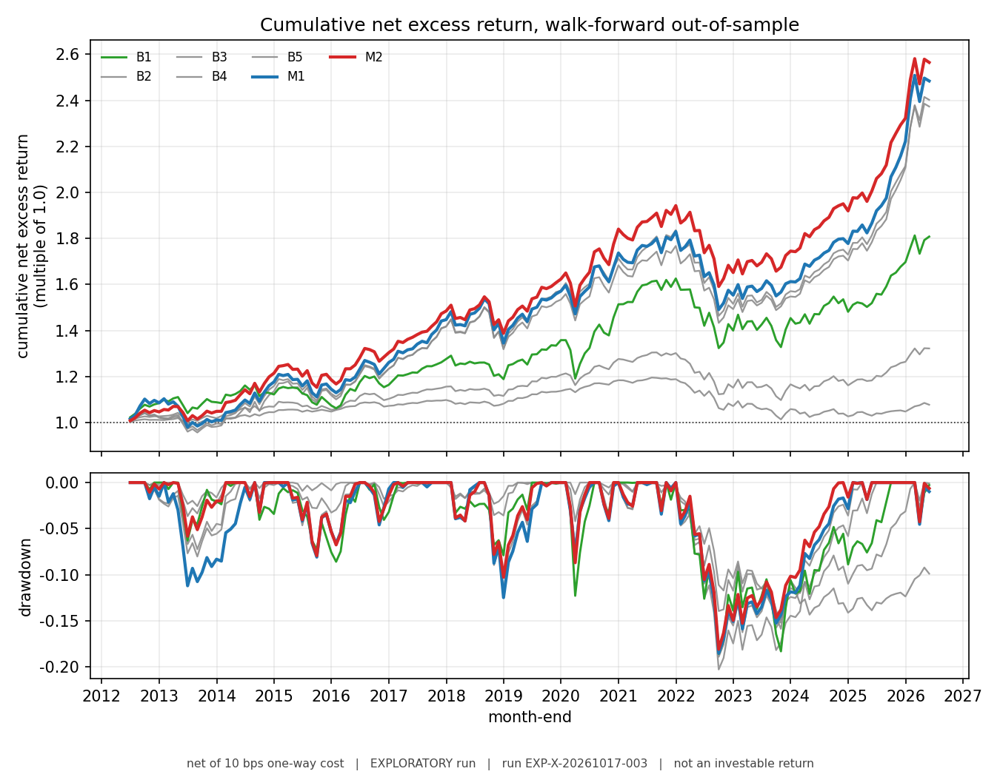
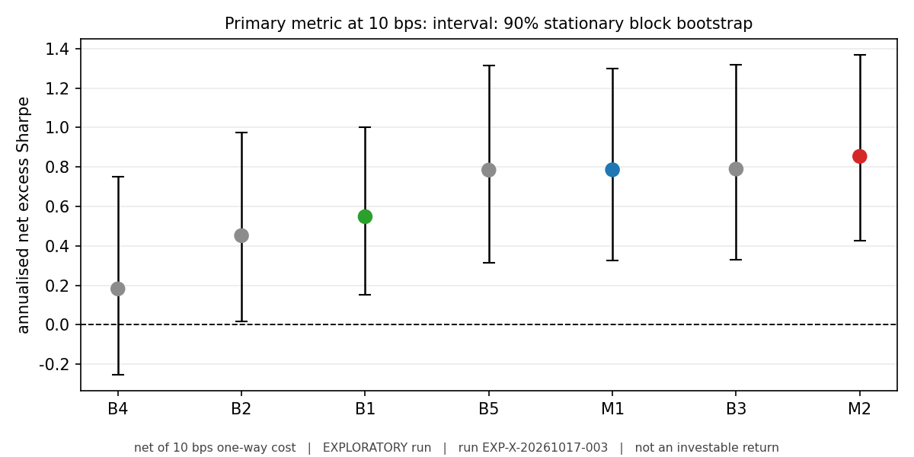

# robustfolio

**Does a robust, turnover-aware portfolio construction method beat a plain one out-of-sample, net of transaction costs — once you adjust for having tried more than one?**

This repository is the benchmark that answers that question under a pre-registered, frozen evaluation protocol. It is built to produce an *honest* answer rather than a favourable one: the hypothesis, the metrics, the thresholds, and the decision rule were all fixed and dated before the results were computed, and a clean "no" is a successful outcome here.

[](docs/evaluation_protocol.md)
[](docs/model_and_method_spec.md)
[](https://github.com/kira-ml/robustfolio/actions/workflows/ci.yml)
[](https://github.com/kira-ml/robustfolio/releases/latest)
[](LICENSE)

---

## Result

> **Exploratory, non-confirmatory** (DEC-20261015-012). These numbers may not be cited for or against any hypothesis. The registered confirmatory test (`EXP-H2-20261017-001`) is **executed (non-confirmatory)**: its answer was observed before it ran, because validating the report generator required executing the frozen configuration (finding **F26**, DEC-20261017-034). No confirmatory test therefore exists, and the hypotheses are **untested, not falsified**. See [Limitations](#limitations) and findings F24–F26, F31.

**Neither robust method was successful under the frozen decision rule.** Over 168 out-of-sample months on a point-in-time universe of 18 US ETFs, the best baseline was `B3` — plain sample-covariance, sample-mean MVO, the method the project set out to critique.

| Method | Net Sharpe @ 10 bps | 90% bootstrap CI | Gross (diagnostic only) |
|---|---|---|---|
| `B1` equal weight (1/N) | 0.5482 | [0.153, 1.002] | 0.5527 |
| `B2` risk parity (ERC) | 0.4519 | [0.017, 0.974] | 0.4592 |
| **`B3` sample MVO — best baseline** | **0.7896** | [0.331, 1.318] | 0.8151 |
| `B4` minimum variance | 0.1820 | [-0.253, 0.751] | 0.1953 |
| `B5` turnover-penalised MVO | 0.7843 | [0.316, 1.316] | 0.7926 |
| `M1` shrinkage-covariance MVO | 0.7860 | [0.327, 1.298] | 0.8077 |
| `M2` Bayesian (Black–Litterman) MVO | **0.8538** | [0.426, 1.369] | 0.8791 |

Net Sharpe is the **only** metric allowed to decide whether a method beats a baseline (protocol §2). `M2`'s advantage over `B3` is **+0.064** against a materiality bar of **0.20** (§6.2), and its probabilistic Sharpe ratio against `B3` is **0.587** against a bar of **0.95** (§6.1). Both candidates therefore return **FAILURE** under §6.4 — `M1` at −0.004 and `M2` at +0.064.

The part worth reading closely: both candidates *pass* the deflated Sharpe p-value (0.0032 and 0.0017), because the DSR is measured against a **zero** benchmark. They fail the PSR, because that is measured against the **best baseline**. §6.1 requires both, and the first run is a live demonstration of why.

**This is not an underpowered null.** The candidates' return series correlate with the best baseline at ρ = 0.9845 and 0.9856, which is inside the region where the design diagnostic found the paired comparison adequately powered for the §6.2 threshold. The paired differences are +0.4% and +0.6% a year. The effect is absent, not invisible.

The deliverable is the **apparatus**, not the number: a leakage-tested walk-forward engine, a numerical certificate, a pre-registered decision rule, and a report that prints the comparison it failed on.



*Run `EXP-X-20261017-003`, net of 10 bps one-way cost, exploratory. Cumulative net **excess** return is the path of the primary metric's input, not an investable return. It is shown because a null is easier to trust when the sample is visible: all seven are the same strategy family on the same 18 instruments, and the four front-runners — `B3`, `B5`, `M1`, `M2` — are visually bundled while spanning 0.784 to 0.854 on the metric, a 0.07 spread their intervals cannot separate. Regenerate with `python scripts/make_figures.py --run results/EXP-X-20261017-003`.*



*The same run's primary metric. `M2` leads the best baseline by +0.064 against a 0.20 bar, and every interval overlaps `B3`'s. The DSR p-values (0.0032, 0.0017) are measured against zero; the PSR (0.495, 0.587) against `B3` — §6.1 requires both.*

---

## Reproduce it

```bash
git clone https://github.com/kira-ml/robustfolio.git && cd robustfolio
python -m pip install -e .
```

**Exact reproduction** — the frozen snapshot, which is the input the table above was computed from. It is a 1.67 MB asset on the [Releases page](https://github.com/kira-ml/robustfolio/releases/latest):

```bash
# The asset, named for its content hash:
#   robustfolio-snapshot-yahoo-usetf-2007-01-01_2026-09-30-2026-10-17-2ad06139.tar.gz
#   SHA-256 7a3fc20991b664099ada44a308dfde57d8080994ff498e2f5a0dd98f2ecab77d
#   That digest is of the *archive* -- the data **plus** its NOTICE.txt. The snapshot's
#   own identity is the bundle hash 2ad0613913df9065b62ba2291abc391402c1eb13d36937ba8c2bbc09d637d707
#   recorded in manifest.json. The two are different things, deliberately (finding F31).
ASSET=robustfolio-snapshot-yahoo-usetf-2007-01-01_2026-09-30-2026-10-17-2ad06139.tar.gz
curl -LO "https://github.com/kira-ml/robustfolio/releases/download/v1.0.0/$ASSET"
python scripts/pack_snapshot.py --verify "$ASSET" --extract-to data/snapshots

# Regenerate the headline number and every table behind it.
python scripts/run_experiment.py --out results/run

# Re-run every method from the archive and assert it reproduces the published
# table, bit-for-bit. Tolerance is exactly zero: this prints EXACT or exits
# non-zero. The reference table is committed, so no prior run is needed.
python scripts/verify_release.py --archive "$ASSET" --run docs/published-run

# The headline figure, from the run directory alone.
python scripts/make_figures.py --run results/run
```

**Independent checks** — no data download, no network:

```bash
python scripts/certify_engine.py    # 7 methods x 168 rebalances, KKT certificate
python -m pytest -q                 # 159 passed, 1 skipped
```

`run_experiment.py` writes `manifest.json` (snapshot id, git commit, protocol and spec versions, seed, environment), `outcomes.csv`, `decisions.csv`, `calibration.csv`, `design.csv`, `folds_<M>.csv`, `net_excess_returns.csv`, and `report.md`.

**The reference table is in the repository.** `docs/published-run/outcomes.csv` is the metric table these numbers come from, committed (4.8 KB) so that the reproduction check can be a *comparison*. Without it a verifier can only ever say "my run finished", which is a different and much weaker statement. CI runs exactly the command above against the release archive, so a code change or a re-uploaded asset fails the build instead of being noticed in six months — see [`docs/published-run/README.md`](docs/published-run/README.md).

**Rebuilding the snapshot is not reproduction.** Yahoo Finance revises history, so `scripts/build_snapshot.py --end 2026-09-30 --retrieval-date <another date>` produces a *different* snapshot with a different content hash and slightly different numbers. That is why the frozen snapshot ships as an asset, and why the archive's digest is published: exact reproduction means the same input, not a similar one.

**The snapshot is redistributed third-party data, and MIT does not cover it.** The prices and corporate actions are Yahoo Finance data, subject to Yahoo's terms, redistributed **solely so the numbers above can be verified** — non-commercially, with attribution. The repository's MIT licence covers the code and this project's own artefacts, not that data. The archive carries a `NOTICE.txt` saying exactly this, so the data cannot be separated from the statement about it. Full policy: [`docs/open_source_and_license_policy.md`](docs/open_source_and_license_policy.md).

---

## Using the harness on your own data

The seam is the **snapshot directory**. A snapshot is five files, and the data layer verifies every hash in `manifest.json` before it will read anything, so nothing downstream can be silently fed a different panel:

| File | Contents |
|---|---|
| `prices_raw.parquet` | `DatetimeIndex` × `MultiIndex` columns `(field, ticker)`, fields `close`/`open`/`high`/`low`/`volume`; **unadjusted** prices |
| `actions.parquet` | `ticker`, `ex_date`, `kind`, `value` — splits and dividends, applied at their ex-date |
| `rf_dgs1mo.parquet` | `date`, `dgs1mo` — the risk-free series, aligned prior-month and annualised geometrically |
| `universe_pit.csv` | `ticker`, `first_eligible`, `last_eligible`, `source_note` — **what makes eligibility point-in-time**; a ticker outside its window is absent, not forward-filled |
| `manifest.json` | per-file SHA-256, content hash, snapshot id, retrieval date, source |

Everything else is generic: `backtest.run_method(snapshot, method_id)` runs one method through the walk-forward loop and returns its per-rebalance record, and `report.build_report(...)` turns a set of those into the table above. `scripts/build_snapshot.py` is the only file that knows how to *produce* a snapshot, and it is the only file you need to change to point the benchmark at a different price panel.

A **release archive** is those five files plus a generated `NOTICE.txt` recording where the data came from and that MIT does not cover it. A snapshot you build yourself will not have one, and does not need one — the notice is about *redistributing* the data, not about reading it.

---

## What is built

| Component | State |
|---|---|
| Evaluation protocol | **Frozen** v2.4 — metrics, thresholds, hypotheses, registry rules, firewalls |
| Method spec | **Frozen** v1.1 — estimators, optimizer, harness, metric definitions |
| Universe | 18 US ETF candidates, point-in-time eligibility (17–18 eligible at each rebalance), anchored 2012-06 |
| Methods | 5 baselines (`B1`–`B5`) + 2 robust treatments (`M1`, `M2`), differing in exactly one component from `B3` |
| Walk-forward harness | 60-month rolling estimation, 12-month non-overlapping test blocks, monthly rebalance, 168 OOS months / 14 folds |
| Optimizer | CVXPY + CLARABEL, **no fallback path**, every rebalance certified by a primal KKT residual against a frozen tolerance |
| Engine certificate | 7 methods × 168 rebalances = **1,176 solves, zero rejections**; worst KKT residual `1.49e-11` vs `1e-7` acceptance |
| Leakage suite | protocol §5.4.8 — 14 pass, 1 recorded skip (the survivorship test is vacuous in-sample; see below) |
| Tests | 159 passed, 1 skipped — including the leakage suite, release-packaging integrity (the notice included), snapshot-name integrity, and the documentation index |
| Release chain | Frozen snapshot packs to a deterministic 1.67 MB archive with a published SHA-256 and a `NOTICE.txt` recording the data's provenance and licence; `verify_release.py` re-runs the harness from the archive and asserts equality with the published table at zero tolerance |
| Continuous integration | Hermetic suite green on a fresh clone by design; with the release asset present, CI also re-runs every method and **verifies the archive reproduces the committed published table at tolerance zero**, and fails if it does not |

---

## Limitations

These are the honest ones, not a disclaimer. The full list is in the report and in [`docs/decision_log.md`](docs/decision_log.md).

- **The headline run is exploratory, and the confirmatory slot is now empty.** Validating the report generator required executing the frozen configuration first, so the registered confirmatory test's answer was observed before the test ran. It has been re-designated **executed (non-confirmatory)** rather than repaired, because blindness cannot be restored once lost (finding **F26**, DEC-20261017-034). The consequence is worth stating plainly: **no confirmatory test now exists**, so no hypothesis is confirmed *or* falsified here — the frozen decision rule returns failure for both candidate methods either way, but it was never applied blind, and this README will not call it a test. What a valid one would require: a **new sample** (a different asset class, or a period that does not yet exist), registered before the data does.
- **"Point-in-time" here means point-in-time *eligibility*, not point-in-time *data*.** The universe is correctly reconstructed from date-stamped eligibility windows, so no instrument appears before it existed. But the prices are what a 2026 source holds for 2012 today, and price history is revised. A perfect reconstruction of Yahoo's current history is still not the history a trader saw.
- **168 out-of-sample months and 18 ETF candidates** (17–18 eligible at any rebalance). This sample can separate roughly a 0.13–0.20 net Sharpe difference between these highly correlated strategies, and not much less.
- **The cost model is a flat 10 bps with no market impact, capacity, taxes, or regime dependence.** Costs cannot reach the optimizer: each rebalance is solved once and every cost level is derived from that single turnover series, so a cost level cannot influence the weights it prices.
- **Survivorship is argued by construction, not measured.** The survivorship test (§5.4.8 test 2) is vacuous in-sample: no confirmed candidate delisted between 2012-06 and 2026-05 (§5.4.5).
- **Data provenance is Yahoo Finance**, frozen into an immutable snapshot with a quality report. It is not an institutional point-in-time vendor feed, and the licence on the third-party data is Yahoo's, not MIT (see above and [`docs/open_source_and_license_policy.md`](docs/open_source_and_license_policy.md)).
- **Two specification readings are disclosed, not silent.** §7.8 leaves the object of its prediction interval undefined, so only the *return* half is reported (coverage 81.5–87.0%); the volatility half is deliberately **not** implemented. §6.3's "advantage" is not pinned to a metric, so fold wins use net Sharpe and the concentration clause uses per-fold mean return — **and that reading decides the verdict here** (findings F24, F25).
- **Not investment advice, and not a claim of tradable alpha.** Nothing here is a live trading system, and no absolute return claim is made (protocol §14.2).
- **The verification path itself had two bugs, and both produced plausible numbers.** The first snapshot verifier rejected *every* valid snapshot, because `manifest.json`'s hash map lists five files while the content hash is derived from four (finding F27). The first comparison of the archived snapshot against the published table reported a `8.3e-17` mismatch on `B4`, because `pandas.read_csv` is lossy by one ULP at its default settings — only `float_precision="round_trip"` is exact (finding F28). Neither error was in the artefact. Both were found only because the expected answer was known to 17 digits, and both are now pinned by tests.

---

## Documentation

The contracts live in [`docs/`](docs/) and are the authority: **if this README and the docs disagree, the docs win.**

- [`docs/evaluation_protocol.md`](docs/evaluation_protocol.md) — frozen metrics, thresholds, hypotheses, registry and firewalls
- [`docs/model_and_method_spec.md`](docs/model_and_method_spec.md) — frozen method, estimator, optimizer and metric definitions
- [`docs/problem_framing.md`](docs/problem_framing.md) · [`docs/scope_and_non_goals.md`](docs/scope_and_non_goals.md)
- [`docs/risk_register_and_premortem.md`](docs/risk_register_and_premortem.md) — how this project fails
- [`docs/decision_log.md`](docs/decision_log.md) — every governance decision, the experiment registry, and findings F1–F29

---

## License

MIT. See [`LICENSE`](LICENSE).

*Robust*, because the binding constraint in practice is rarely sophistication and usually robustness to estimation error, non-stationarity, and frictions. *Folio*, because the object of study is the portfolio, not the signal.
